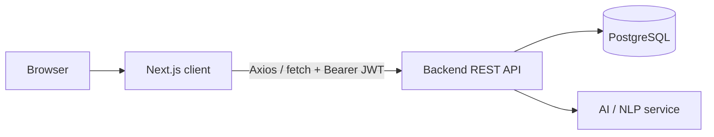
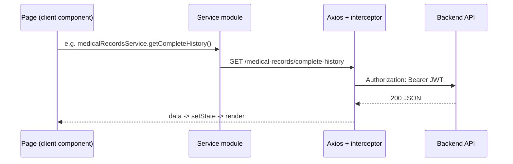

# Architecture

Back to [[Welcome]] · Next: [[Tech-Stack]]

## System split

PulmoAI is delivered as two repositories that communicate over HTTP and JSON:

| Repository | Responsibility | Documented here |
|---|---|---|
| `pulmo-ai` (this vault) | Next.js web client with three role-based portals | Fully |
| `pulmo-ai-backend` | REST API, authentication, PostgreSQL via Prisma, AI/NLP services | From the client's view only. See [[PostgreSQL-Prisma-Schema]] |

> [!NOTE]
> The frontend is not a monorepo. The backend is a separate repository referenced from the project README.



## Frontend folder layout

```text
pulmo-ai/
├── .github/workflows/ci-cd.yml   # GitHub Actions, see [[CI-CD-Workflow]]
├── middleware.ts                 # Next.js middleware (see [[Security-And-RBAC]])
├── public/                       # Static assets
├── src/
│   ├── app/                      # App Router pages
│   │   ├── page.tsx              # Landing page
│   │   ├── auth/{patient,doctor,admin}/{sign-in,sign-up}
│   │   ├── patient/              # See [[Patient-Portal]]
│   │   ├── doctor/               # See [[Doctor-Portal]]
│   │   └── admin/                # See [[Admin-Portal]]
│   ├── components/
│   │   ├── common/               # See [[Common-Components]], [[Modals-Library]]
│   │   ├── admin/ doctor/ patient/   # Sidebars, auth banners
│   │   └── landing/              # Marketing sections
│   ├── services/                 # See [[API-Client]] and service notes
│   └── types/                    # See [[TypeScript-Interfaces]]
├── ARCHITECTURE.md, AGENTS.md, CLAUDE.md   # Project and AI-assistant guidelines
└── package.json, tsconfig.json, eslint.config.mjs, postcss.config.mjs, next.config.ts
```

## Routing model

Next.js App Router, one route group per role. Each role has its own `layout.tsx` that supplies the sidebar, header and avatar. See [[Layouts-And-Navigation]].

| Prefix | Audience |
|---|---|
| `/` | Public landing page |
| `/auth/{role}/sign-in`, `/auth/{role}/sign-up` | Role-specific authentication |
| `/patient/*` | Patients |
| `/doctor/*` | Doctors |
| `/admin/*` | Administrators |

## Request lifecycle

1. The user signs in on a role-specific page. See [[Authentication-Service]].
2. The backend returns a JWT (`accessToken`), which the client stores in `localStorage` under `token`.
3. A page component (always a client component) calls a function in `src/services/`.
4. The service uses the shared Axios instance. Its request interceptor adds `Authorization: Bearer <token>`. See [[API-Client]].
5. The backend validates the token and role, queries PostgreSQL and returns JSON.
6. The page stores the result in React state and renders cards, tables and modals. See [[Common-Components]].



## Design conventions

- TypeScript throughout, Tailwind CSS 4 for styling, Lucide and MUI icons.
- Feature-based services: one module per business area. See [[API-Endpoint-Reference]].
- Reusable cards and modals shared across portals. See [[Common-Components]] and [[Modals-Library]].
- Local component state (`useState`/`useEffect`) is used for data fetching today.

> [!INFO] Planned versus current
> The project guideline files describe Redux Toolkit, Zod, React Hook Form and React Query as target conventions. They are **not yet in `package.json`**, so the current app uses plain React state. See [[Tech-Stack]].
