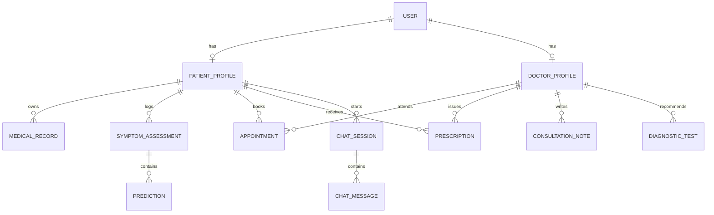

# PostgreSQL and Prisma Schema

> [!IMPORTANT] Source of truth
> The database schema lives in the **backend repository** (`schema.prisma`), which is not part of the code reviewed for this vault. The model overview below is **inferred from the fields the frontend sends and receives**. Verify names and relations against the backend before relying on it.

Per the project guidelines ([[Tech-Stack]]), all persistence goes through PostgreSQL managed by Prisma, with strict relational integrity between users, consultations, prescriptions and medical records.

## Inferred entities

| Entity | Evidence in the client | Key fields |
|---|---|---|
| User | Sign-in response, `role`, admin user list | `id`, `email`, password hash, `role` (patient, doctor, admin), status, last login |
| PatientProfile | `/patient/profile` | `fullName`, `phoneNumber`, `gender` (`MALE`/`FEMALE`/`OTHER`), `address`, `dateOfBirth`, `bloodGroup` |
| DoctorProfile | Doctor sign-up and admin verification | `fullName`, `licenseNumber`, `specialization`, `hospital`, `qualifications`, `experience`, `consultationHours`, verification status |
| Clinic | `/admin/clinics` | name, location, phone, type, specialists count, active flag |
| Appointment | `/patient/appointments`, `/doctor/appointments` | patient, doctor, date/time slot, status (e.g. `Completed`) |
| MedicalRecord | [[Medical-Records-Service]] | `primarySymptom`, `durationInDays`, `diagnosis`, `symptomsDiscussed`, `recommendations`, `confidenceScore`, `urgencyLevel`, `medicalHistory` |
| SymptomAssessment and Prediction | `/patient/symptoms` | `symptomText`, `urgency`, `recommendedSpecialist`, `modelName`, `modelVersion`; predictions `{ condition, confidence, rank }` |
| Prescription | `/doctor/prescriptions` | patient, doctor, `medicationName`, `dosage`, `frequency`, `duration`, `instructions` |
| DiagnosticTest | `/doctor/tests` | patient, `testName`, `description`, `status` |
| ConsultationNote | `/doctor/consultation-notes` | patient, `diagnosis`, `primarySymptom`, `urgency`, `medicalHistory` |
| ChatSession, ChatMessage, Attachment | `/patient/chatbot/*` | title, `updatedAt`, role, content, file name, MIME type, size |
| Notification, AuditLog / SecurityAlert | Admin pages | title, type, read flag, severity, status |
| UserPreferences | Settings services | email notifications, reminders, health tips, language, time zone, dark mode |

## Relationship sketch

## Domain rules the schema must support

- Prescriptions are created or updated only by **verified** doctors tied to a consultation ([[Security-And-RBAC]]).
- Urgency values drive the High-urgency prompt in the [[Patient-Portal]].
- Doctor accounts remain pending until an admin approves them ([[Admin-Portal]]).

Client-side shapes: [[TypeScript-Interfaces]].
